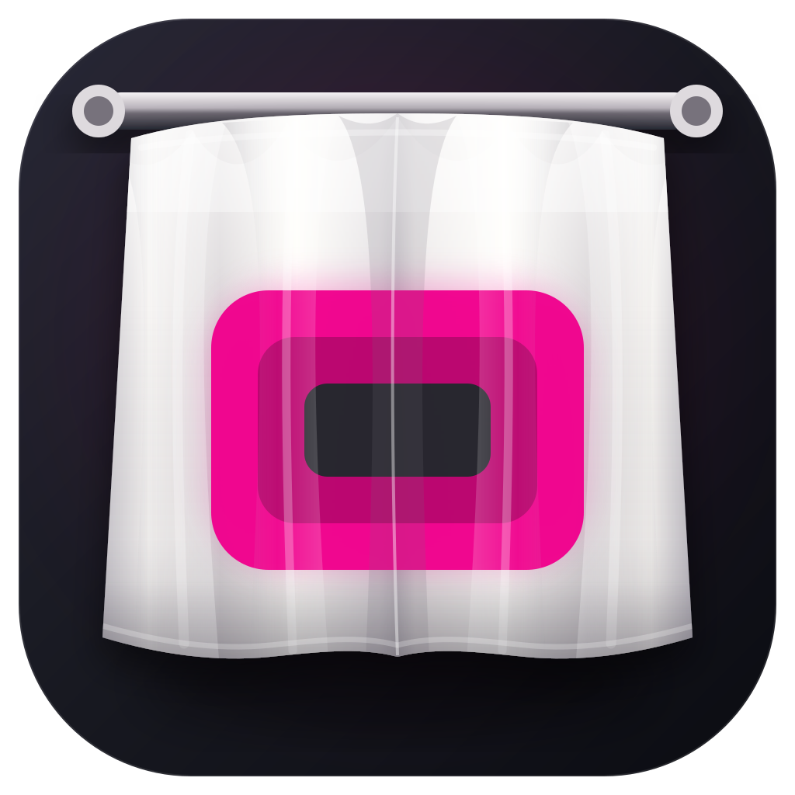

<p align="center">
  
</p>

# Scrim / Flywire prototype

**Experimental preview.** Scrim is for local testing and rehearsals on the same
Mac as the Flywire-enabled FreeShow build below. Keep FreeShow's Electron output
available as a fallback. This is not a supported or notarized release.

Scrim is an optional native macOS output for FreeShow. FreeShow still owns show
state, templates, dynamic values, line selection and its normal Electron output
windows. It publishes each resolved output as a full scene over **Flywire**
(socket.io on `http://127.0.0.1:5514`), and Scrim draws that scene on a display.

The prototype supports normal outputs with a solid, image, video or screen/window
background plus text. Anything else in a scene is listed as unsupported and stays
on the Electron renderer.

**Tested so far:** photo and video slides with some text, on one Mac. Switching
between two FreeShow feeds on one HDMI display passed a hardware smoke test, and
Scrim presented and switched feeds with the displays `HDMI TO USB` and
`BMD HDMI` assigned in the same session. Two-display unplug/replug and wider
multi-output use are not yet qualified for live use.

## Quick start

You need two things running on the same Mac:

- **FreeShow from this branch.** The FreeShow app from freeshow.app does not have
  Flywire and cannot feed Scrim.
- **Scrim**, either as a packaged `Scrim.app` or run from source.

### 1. Run FreeShow from this branch

Install Node.js 22.12 or later and the
[FreeShow development prerequisites](../README.md#help-the-development), then:

```sh
git clone --branch scrim/1.6.7-port https://github.com/jquyatt/FreeShow.git FreeShow-Scrim
cd FreeShow-Scrim
npm install
FS_MOCK_STORE_PATH=/tmp/freeshow-scrim npm start
```

Quit any other copy of FreeShow first. `npm start` frees port 3000 for its dev
server. `FS_MOCK_STORE_PATH` keeps this copy's settings and outputs in a
throwaway folder; leave it off to test with your own setup. Show files still go
to `~/Documents/FreeShow` either way.

In FreeShow:

1. **Settings → Connections:** enable **Scrim / Flywire**.
2. **Settings → Outputs:** pick an output and enable **Publish this output over
   Flywire**. Leave **Use Scrim instead of the Electron output window** off for
   now, so Electron stays as the fallback.
3. Turn on **Present** and show a slide.

### 2. Run Scrim

You need Xcode 16 or later (Swift 6) for either option. The easiest is the
packaged app:

```sh
npm run scrim:package
```

This writes `Scrim.app` and a ZIP to a new folder under `dist/`. Open
`Scrim.app` and a preview window appears showing the `default` output. To drive
an external display, use the Scrim icon in the menu bar: **Displays →** pick a
display → pick a feed.

The app is ad-hoc signed for local testing only. It doesn't include FreeShow.

To run from source instead, from the repository root:

```sh
npm run scrim:windowed    # 16:9 window, no second display needed
npm run scrim             # fullscreen on an external display
```

The first run builds Scrim with Swift Package Manager and downloads its
dependencies, so it takes a minute.

## Using Scrim

### Feeds and displays

A feed is a FreeShow output ID, such as `default`, not a macOS display number.
FreeShow logs the IDs it publishes as `[Flywire] configured output IDs`. Scrim
picks its first feed from `--output`, then the `SCRIM_OUTPUT_ID` environment
variable, then `default`.

From the menu bar icon:

- **Displays** assigns a feed to each external display. Repeat for a second
  display to drive both at once. The list refreshes each time the menu opens.
- **Preview Feed** changes only the windowed preview.
- **Turn Off This Display** removes that display's assignment for this session.
- **About Scrim** shows the version, credits and a link to the fork.

When you switch feeds, the current one keeps playing until the new scene is
ready, then Scrim cuts to it. If the new scene doesn't arrive within ten seconds,
Scrim stays on the current feed. The feed menu needs a FreeShow build that
publishes its feed list; older builds only support the launch-time `--output`.

Unplugging a display suspends only its assignment, which comes back when the
same display returns. Scrim never puts output on a newly connected display by
itself, except to resolve the initial fullscreen launch target.

Scrim launches without taking focus. Quit from the menu bar icon, or with
Control-C if you started it from a terminal.

### Launch options

| Option | Effect |
| --- | --- |
| `--output ID` | Initial feed |
| `--windowed` | 16:9 resizable window (default for `Scrim.app`) |
| `--fullscreen` | Fullscreen (default for `swift run`) |
| `--screen N` | Initial macOS display index |
| `--host URL` | Flywire endpoint. FreeShow listens on loopback only, so this is for local test servers |

Without `--screen`, fullscreen uses the first active, non-mirrored external
display that isn't the main display. It never falls back to the main display; use
`--windowed` for that.

For a deliberate HDMI test, confirm the screen index, quit any windowed copy and
run:

```sh
open -a /path/to/Scrim.app --args --fullscreen --screen 1 --output default
```

If that display is unplugged, Scrim hides the window and waits for the same
display to return.

With `swift run`, pass options after `--`, for example
`npm run scrim:windowed -- --output sanctuary`.

### Output modes

Each output has two toggles under **Settings → Outputs → Scrim (prototype)**:

| Mode | Publish over Flywire | Use Scrim instead of the Electron output window |
| --- | --- | --- |
| Electron only (default) | off | off |
| Dual render | on | off |
| Scrim only | on | on |

Scrim only closes that output's physical Electron window. FreeShow's main
process stays, along with a hidden text-only Chromium host that measures
typography and line breaks. Scrim's video is always muted, so use dual render
whenever the Electron window is your program-audio source.

## Testing

```sh
swift test --package-path scrim   # Swift tests
npm run test:unit                 # TypeScript unit tests
npm run scrim:capture-check       # capture permission + disposable window/display probe
npm run scrim:capture-test        # end-to-end Flywire/preview probe with temporary windows
node scrim/Tools/feed-switch-demo.mjs
```

The capture commands need Screen Recording permission and don't touch your show.
macOS grants it to whatever launched Scrim. For `Scrim.app`, use **Allow Screen
Capture…** in its menu and restart Scrim. From a terminal, grant it to the
terminal app (Terminal, iTerm, your editor) in **System Settings → Privacy &
Security → Screen Recording**, then restart the terminal. Screen/window
backgrounds need the same permission.

`feed-switch-demo.mjs` is an HDMI smoke test without FreeShow. Launch Scrim with
the `--host` it prints. It offers two differently colored feeds (the second
starts late) and a third that never sends a scene, so you can check both the cut
and the ten-second timeout on a capture card.

To point **About Scrim** at another fork, set `SCRIM_REPOSITORY_URL` to its HTTPS
GitHub URL when running `npm run scrim:package`.

## How it renders

**Output.** The window is borderless, fills the selected display in pixels,
never activates, and draws on `CVDisplayLink`.

**Transitions.** Each take arrives as a media layer and a complete text layer.
The compositor keeps the previous layers and applies FreeShow's media and text
transitions independently. Only **None** (a true hard cut) and **Fade** are
supported, with the authored duration and easing. Other effects are reported and
shown as hard cuts rather than approximated. Identical text across a take stays
put with no dip.

**Prewarming.** FreeShow publishes media up to three slides ahead and one behind.
Scrim decodes those images and video first frames concurrently, into bounded
caches, without starting playback.

**Video.** Background video uses the same opaque asset URL, decodes with
AVFoundation, is aspect-fitted to the canvas and always muted. It follows
FreeShow's playback state: playhead, pause, rate, loop and **Clear media when
finished**. A non-looping video either clears or holds its last frame. FreeShow
remains the only source of program audio.

**Screen and window capture.** Backgrounds chosen from FreeShow's Screen source
use ScreenCaptureKit. Flywire carries the source identity, never pixels, and one
capture stream feeds both program and operator preview. A capture waits for its
first complete frame before presenting and holds its last frame if the source
closes. See `docs/scrim/FLYWIRE_LIVE_SOURCE_CONTRACT.md`.

**Fail-closed media.** A scene with an image isn't presented until the image
decodes; a video scene waits until AVFoundation opens the track and decodes a
first frame. A missing or unreadable asset leaves the last valid scene on screen
and logs the output, revision, asset and reason. Media outside the prewarm window
goes through the same check on demand.

**Operator preview.** For Scrim outputs, FreeShow's preview shows reduced-size
frames sent back by Scrim instead of a second Chromium scene. Still scenes send
one frame per revision; video and transitions are capped at 15 fps. The
transport is lossy and can never block program output. See
`docs/scrim/SCRIM_NATIVE_PREVIEW_CONTRACT.md`.

## Text fidelity

FreeShow publishes Chromium's final autosized font size and its UTF-16
visual-line ranges. Scrim shapes those exact lines with CoreText and never wraps
text itself. The renderer has no font-size fudge factor and no copy of CSS
balanced wrapping. Two translation bugs were found and fixed along the way: a
zero kern value disabled font kerning, and CSS line height mapped to the wrong
CoreText property. The representative forced-break matrix now matches with
subpixel differences. See `docs/scrim/FLYWIRE_TEXT_LAYOUT_CONTRACT.md`.

To compare by eye, import `Fixtures/autosize-comparison.show` (a real
shrink-to-fit slide), show it at 1920×1080 in both renderers, and compare font
size, line breaks, height and baseline. The matching scene fixture is covered by
`swift test`.

To regenerate the measurement artifacts after `npm install`:

```sh
node scrim/Tools/chromium-fidelity.mjs
node scrim/Tools/forced-break-fidelity.mjs
cd scrim
SCRIM_FIDELITY_OUTPUT="$PWD/Artifacts/coretext-fidelity.json" swift test
SCRIM_FORCED_FIDELITY_OUTPUT="$PWD/Artifacts/forced-break-coretext.json" swift test
```

## Protocol decisions

- Flywire v1 sends full scenes, not diffs.
- Coordinates are target pixels with a top-left origin.
- Text is literal, with structured runs, Chromium's autosize result and its
  visual-line ranges when available. CoreText still does the shaping.
- Media is referenced by an opaque `assetId`. Electron registers local paths and
  serves them only as `/assets/{assetId}`. Background media declares whether it
  is an image or video. A separate `PLAYBACK` message carries FreeShow's audio
  clock, loop, rate and clear-on-end policy.
- A consumer must prepare every asset before presenting a revision. If
  preparation fails, it rejects that revision rather than showing an empty or
  background-only scene.
- Every scene carries independent media and text transitions: `cut` or `fade`,
  a duration in milliseconds, and one of FreeShow's easings (`linear`, `back`,
  `sine`, `circ`, `cubic`, `elastic`, `bounce`).
- `ScrimCore` has no AppKit or Socket.IO dependency, so the scene and compositor
  code can move to iOS/iPadOS later.

## Out of scope

Video items, stage outputs, overlays, effects, NDI and other network inputs,
PDF/PPT, cameras, web content, drawings and a polished operator UI.

## Further reading

| Document | What it covers |
| --- | --- |
| `docs/scrim/GIG_READINESS_GATE.md` | What must pass before a supervised live show, and current status |
| `docs/scrim/FLYWIRE_TEXT_LAYOUT_CONTRACT.md` | Text layout wire format |
| `docs/scrim/FLYWIRE_LIVE_SOURCE_CONTRACT.md` | Screen/window capture wire format |
| `docs/scrim/SCRIM_NATIVE_PREVIEW_CONTRACT.md` | Operator preview transport |
| `docs/scrim/PERFORMANCE_RESULTS_2026-08-24.md` | Electron vs dual vs Scrim-only measurements |
